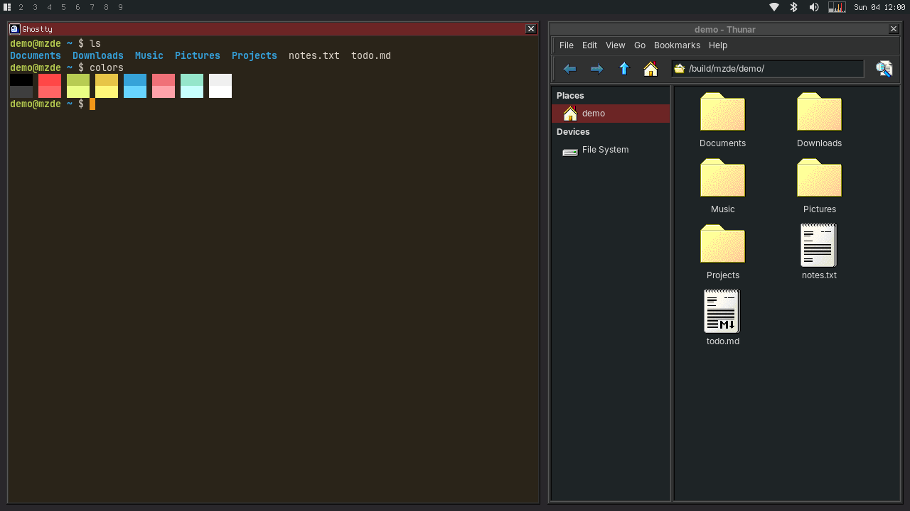
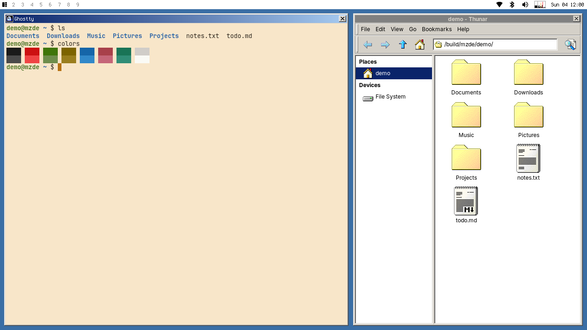
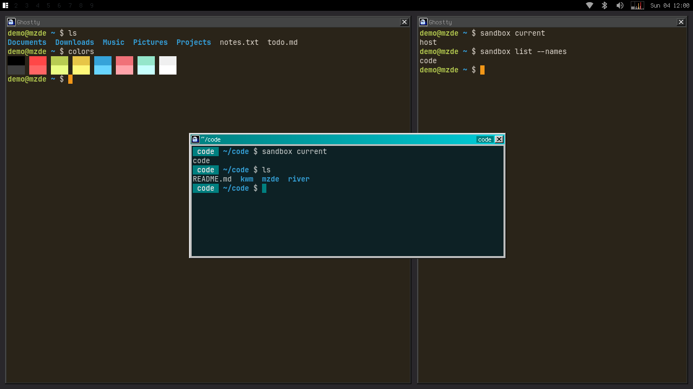

# mzde

mzde is a NixOS desktop with [river](https://codeberg.org/river/river),
[kwm](https://github.com/menduz/kwm), the
[win-classic theme](https://github.com/menduz/win-classic-theme), and
[waylock](https://github.com/menduz/waylock).




- Hold Super for two seconds to show the key bindings.
- Use Super+Shift O to change between the light and dark themes.
- Use Super+Alt 1 for a screenshot, or Super+Alt 4 to select an area.
- swayidle locks the screen, switches off the displays, and suspends the system.
- The bar shows tags, system activity, notifications, and the system tray.
- Sandboxes have separate home directories, network settings, and colors. kwm shows the sandbox name on each window.

## Use

Import the mzde and Home Manager NixOS modules in your system configuration:

```nix
{
  inputs.mzde = {
    url = "git+https://github.com/menduz/mzde.git?ref=main";
    inputs.nixpkgs.follows = "nixpkgs";
    inputs.home-manager.follows = "home-manager";
  };

  outputs = { nixpkgs, home-manager, mzde, ... }: {
    nixosConfigurations.box = nixpkgs.lib.nixosSystem {
      system = "x86_64-linux";
      modules = [
        home-manager.nixosModules.home-manager
        mzde.nixosModules.default
        {
          mzde.enable = true;
          mzde.keymap.layout = "us";
        }
      ];
    };
  };
}
```

Select the `river` session in the display manager.
Use `mzde.sessionTarget` (`river-session.target`) for session services.

## Sandboxes

Add this example to a NixOS module:

```nix
{ pkgs, ... }:
{
  programs.sandboxes = {
    enable = true;
    environments.work = {
      description = "Development";
      backend = "bwrap";
      winTheme.preset = "teal";
      paths = [ "~/code" ];
      git = "read";
      lanAccess = false;
      commands.make = pkgs.gnumake;
    };
  };

  mzde.sandboxes.homeManagerUser = "alice";
}
```

Replace `alice` with your Home Manager user name.
Create `~/code` before you start the sandbox.

The `work` sandbox keeps its home directory between runs.
It can write to the host directory `~/code` and read the host Git configuration.
It has internet access, but no access to local networks.
The `make` command runs only in sandboxes that define it.
On the host, this command stops with an error.

Press Super+Space to open the rofi sandbox menu.
Select a sandbox, or select `host` to run the program on the host.
rofi then shows the program menu.
Select a program to start it in the selected sandbox.
The program menu uses the theme of that sandbox.
Use Super+Return to select a sandbox and open its terminal.
These menus also include the host.
A custom binding for these keys replaces the menu.



```sh
sandbox list
sandbox run work
sandbox run work -- make -C ~/code/project
sandbox current
sandbox ps
sandbox stop work
```

`mzde.sandboxes.homeManagerUser` gives each sandbox selected Home Manager files with read-only access.
Each sandbox gets its own GTK theme and Ghostty colors.

The `bwrap` backend uses the host kernel.
For gVisor, set `backend = "gvisor";` and `gui = false;`.
The terminal menu then opens Ghostty on the host with a shell in the sandbox.
GUI sandboxes share the host Wayland socket, which permits access to compositor functions such as screen capture.

Refer to [the sandbox instructions](sandboxes/README.md) for access controls, commands, network settings, and backend limits.
For use without the desktop, import `mzde.nixosModules.sandboxes`.

## Options

Refer to [nix/options.nix](nix/options.nix) for the desktop options.

- `mzde.bindings`, `mzde.floatRules`, `mzde.startupCommands`: key bindings, floating windows, and startup commands.
- `mzde.terminal`, `mzde.keymap`, `mzde.keyRepeat`, `mzde.naturalScroll`: terminal and input settings.
- `mzde.bar.center`, `mzde.bar.right`, `mzde.bar.end`: bar widgets.
- `mzde.colors`, `mzde.kwm.settings`: colors and window manager settings.
- `mzde.lock.*`: idle timers and the command after unlock.
- `mzde.rofi.*`: menu settings.
- `programs.win-classic-theme.*`: desktop theme.
- `programs.sandboxes.*`: sandbox settings in [sandboxes/module.nix](sandboxes/module.nix).
- `mzde.sandboxes.*`: desktop integration in [nix/sandboxes.nix](nix/sandboxes.nix).

## Development

To use a local input, add `--override-input kwm git+file:///path/kwm` to the Nix command.
From a parent flake, use `--override-input mzde/kwm git+file:///path/kwm`.

Run the applicable check:

```sh
nix build .#checks.x86_64-linux.sandboxes
nix build .#checks.x86_64-linux.lock-prompt
nix build .#checks.x86_64-linux.kwim-apply
```

The checks test sandbox operation, lock prompt position, and input settings after a delayed river response.

Run `nix run .#screenshots` to update the desktop screenshots.
Run `nix build .#screenshots` to build the screenshots.
The build also creates `sandbox.png`: two host terminals and a floating terminal in the `code` sandbox, with the dark desktop theme and the teal sandbox theme.
All screenshots use fixed clock, CPU, memory, disk, and tray values.
The demo system in `dev/demo.nix` copies the theme, bar, and sandbox settings of nix-config.
A mock cgroup puts the sandbox terminal in the `code` sandbox for kwm.
