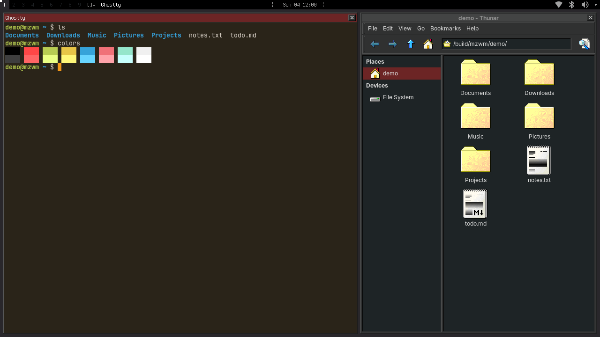
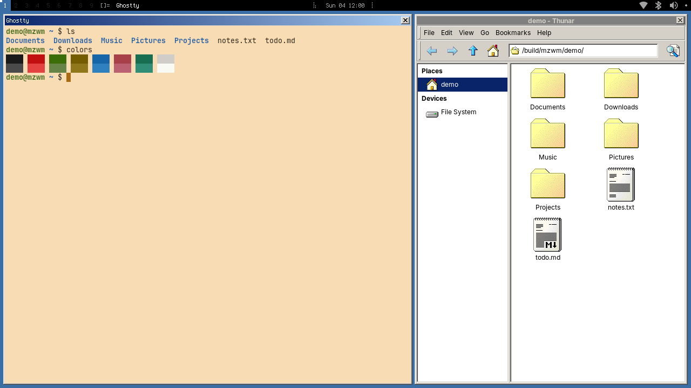

# mzwm

A desktop for NixOS: [river](https://codeberg.org/river/river) (the main
branch, with patches) and the [kwm](https://github.com/menduz/kwm) window
manager, the [win-classic](https://github.com/menduz/win-classic-theme) theme
for GTK, kwm and rofi, and the [waylock](https://github.com/menduz/waylock)
screen locker.




- The kwm bar: tags, layout, title, memory, clock, CPU, busy disks, privacy
  (microphone and camera), sleep inhibitors, media, docker, battery, disk
  usage, the notifications of dunst, and the system tray
  (`nix/widgets.nix`).
- Key bindings with an overlay: hold Super for 2 seconds.
- rofi menus as modal dialogs in the style of the theme (`mz-rofi`).
- swayidle locks the screen, turns off the outputs and suspends.
- kwm-portal: programs can stop the idle timers (the Inhibit portal).
- `toggle-theme` (Super+Shift O) changes between the light and the dark
  scheme without a rebuild.
- Screenshots with `scrn` (Super+Alt 1) and `slurpscrn` (Super+Alt 4), the
  wlr and GTK portals (screen sharing with a rofi chooser), polkit.

## Use

mzwm is a NixOS module. It needs the NixOS module of Home Manager: it gives
the user part of the desktop to each Home Manager user.

```nix
{
  inputs.mzwm = {
    url = "git+https://github.com/menduz/mzwm.git?ref=main";
    inputs.nixpkgs.follows = "nixpkgs";
    inputs.home-manager.follows = "home-manager";
  };

  outputs = { nixpkgs, home-manager, mzwm, ... }: {
    nixosConfigurations.box = nixpkgs.lib.nixosSystem {
      system = "x86_64-linux";
      modules = [
        home-manager.nixosModules.home-manager
        mzwm.nixosModules.default
        {
          mzwm.enable = true;
          mzwm.keymap.layout = "us";
          mzwm.bindings."Super Return" = "ghostty";
        }
      ];
    };
  };
}
```

The display manager shows the session "river". Start the session programs
with `mzwm.sessionTarget` (`river-session.target`).

## Options

All options are in `nix/options.nix`.

- `mzwm.bindings`, `mzwm.floatRules`, `mzwm.startupCommands`: key bindings
  that run commands, windows that float, programs to start.
- `mzwm.terminal`, `mzwm.keymap`, `mzwm.keyRepeat`, `mzwm.naturalScroll`.
- `mzwm.bar.center`, `mzwm.bar.right`, `mzwm.bar.end`: more widgets.
  `mzwm.lib.scriptWidget` makes a widget from a script.
- `mzwm.colors`, `mzwm.kwm.settings`: colors, and other values for the
  configuration of kwm.
- `mzwm.lock.*`: idle times, and a command after the unlock.
- `mzwm.rofi.plugins`; `mzwm.rofi.package` is the `mz-rofi` command.
- `mzwm.toggleTheme` is the `toggle-theme` command.
- `programs.win-classic-theme.*`: the theme. Refer to win-classic-theme.

## Development

The inputs `river`, `kwm`, `waylock`, `win-classic-theme` and
`mz-term-colors` are the forks on GitHub. To build with local checkouts, use
`--override-input`, for example `--override-input kwm git+file:///path/kwm`.
From a flake that has mzwm as an input, use `--override-input mzwm/kwm ...`.

`nix run .#screenshots` writes `screenshots/dark.png` and
`screenshots/light.png`: river with the headless backend, kwm with the
configuration of a demo system (`dev/demo.nix`), Thunar and Ghostty (Mesa
draws for Ghostty with the processor). The clock, the CPU, the memory and the
disk always have the same values, so the images change only when the desktop
changes. `nix build .#screenshots` only builds them; the build is
reproducible.

`nix build .#checks.x86_64-linux.lock-prompt` tests the patches of river and
waylock: the password prompt stays in the center after a change of the output.
